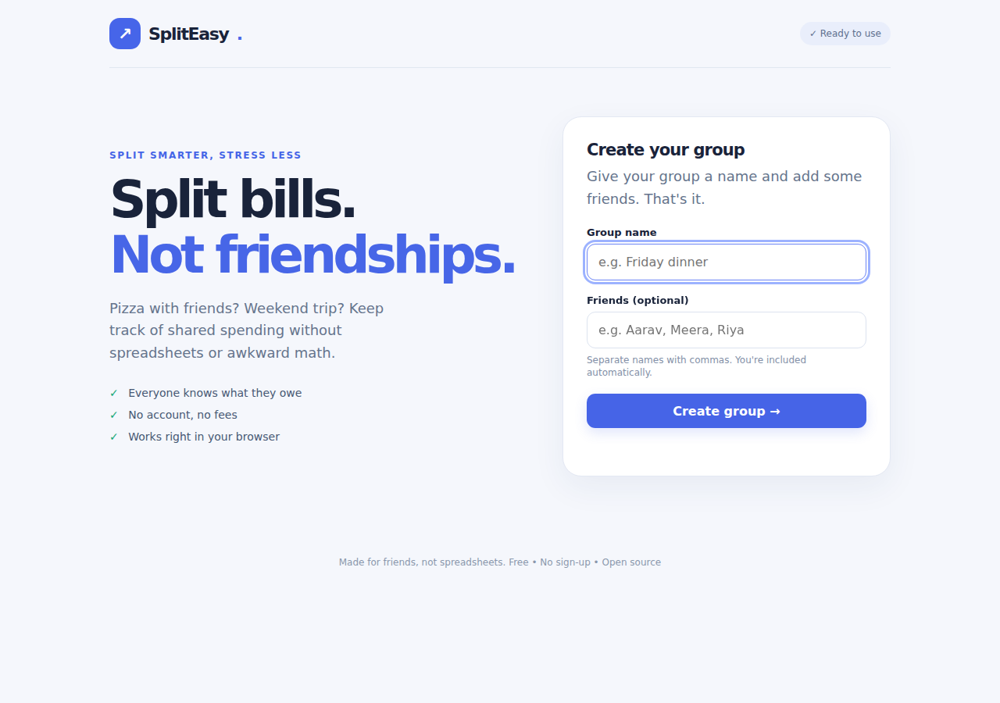
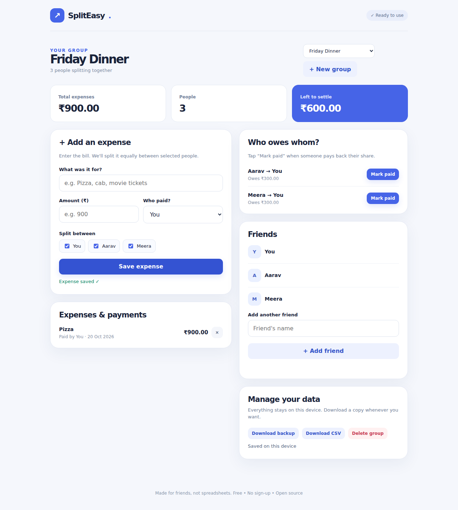

# SplitEasy 💸

### Split bills. Not friendships.

**SplitEasy is a free, no-sign-up expense splitter for friends.** Create a group, enter what someone paid for, and instantly see who owes whom—without a spreadsheet, a calculator, or awkward group-chat math.



**🌐 Live demo:** _Link coming after the GitHub Pages deployment._  
**⚡ Try it locally:** Download this repository and open [`index.html`](index.html) in Chrome or Edge. No installation, accounts, API keys, or server are required.

> **The idea:** Keeping track of shared expenses should take less effort than paying for them.

## Try it in 30 seconds

1. **Create a group.** Call it `Friday Dinner` and add `Aarav, Meera` (you're included automatically).
2. **Add a bill.** Enter `Pizza`, `₹900`, and choose `You` as the person who paid. Leave all three group members selected.
3. **See the answer.** SplitEasy shows **Aarav → You: ₹300** and **Meera → You: ₹300**.
4. **Settle up.** When Aarav actually gives you ₹300, tap **Mark paid**. The app records it and updates what's still owed.



*The screenshots show example group data, not real users' finances.*

## What can it do?

- **Create groups:** Keep a dinner, trip, or household's expenses separate. Add friends whenever you need to.
- **Add shared bills:** Enter the amount, name the payer, and select who should share the cost.
- **Split fairly:** Divide a bill equally across the selected members, including sensible rounding for amounts that do not divide evenly.
- **See who owes whom:** Convert everyone's combined spending into a simpler list of suggested repayments.
- **Record settlements:** **Mark paid** updates the balance after someone pays back a friend; it never transfers money.
- **Keep your records:** Review past expenses and repayments, delete incorrect entries, and export group transactions as CSV or all local data as JSON.
- **Use it anywhere:** Responsive layout for phones and desktops. Data is saved in the browser on the device you're using, when browser storage is available.

## Why not just use a calculator?

A calculator is fine for one pizza. It becomes frustrating when three people pay for different things across a whole weekend. SplitEasy accounts for **who paid** and **who benefited** from *every expense*, then combines the results. That way, you don't have to calculate every pair of debts by hand.

It is deliberately small. There is **no account system, no bank connection, and no subscription**. You can open it and start splitting.

## Run it on your computer

**Requirements:** A modern browser with JavaScript enabled (Chrome, Edge, Firefox, or Safari). No Node.js, Python, database, or package installation is necessary.

1. Click **Code → Download ZIP** on GitHub and extract the ZIP.
2. Open `index.html` in your browser.
3. Look for the **✓ Ready to use** indicator, then create a group.

You can also serve the folder with any static web server or host it on **GitHub Pages**. Hosting over HTTPS is recommended if your browser restricts scripts or local storage on `file://` pages.

### Deploy with GitHub Pages

In your public repository, open **Settings → Pages**. Choose **Deploy from a branch**, set the branch to `main` and folder to `/(root)`, and save. After GitHub publishes the site, copy its URL into the **Live demo** line near the top of this README. Test the deployed link in a fresh browser window before sharing it.

## How the math works (behind the scenes)

The entire app runs in the browser using plain **HTML, CSS, and JavaScript**. The expense logic follows three steps:

1. **Record an expense.** The payer is credited the full cost. Everyone sharing it is charged their portion—even the payer, if they're included.
2. **Calculate net balances.** For every person, add what they paid and subtract what they owe for their shares. Recorded repayments are also accounted for.
3. **Suggest settlements.** Match people who owe money with those who should receive it. Only the outstanding balances are shown, rather than every original expense being treated as a separate debt.

**Example:** For a ₹900 bill shared equally by You, Aarav, and Meera:

| Person | Paid | Share | Net balance |
| --- | ---: | ---: | ---: |
| You | ₹900 | ₹300 | +₹600 |
| Aarav | ₹0 | ₹300 | −₹300 |
| Meera | ₹0 | ₹300 | −₹300 |

The app suggests two ₹300 repayments to you. Once Aarav's repayment is recorded, only Meera's ₹300 remains outstanding.

**Money is tracked as integer paise**, not floating-point rupees. This avoids common currency calculation issues such as `0.1 + 0.2` producing an imprecise result. When there is a remainder after dividing a bill, the extra paise are distributed across the first selected members so the shares add up to the original amount exactly.

### Where is my data stored?

Groups, expenses, and repayments are kept in your browser's `localStorage`. Nothing is uploaded to a SplitEasy server. This is simple and private for one-device use, but it also means another phone or browser **will not automatically see the same data**.

Use **Download backup** for a JSON copy and **Download CSV** for a shareable spreadsheet-style record. The current version can *export* JSON but **cannot import it back** yet.

## Project files

```text
spliteasy/
├── index.html             # The entire app (UI, styling, logic)
├── screenshots/
│   ├── welcome.png        # Start screen
│   └── dashboard.png      # Expense tracking in action
├── README.md              # You are here
├── LICENSE                # MIT license
└── SUBMISSION-NOTES.md    # Stardance publishing checklist
```

## Test it yourself

Here is a practical checklist for verifying the main features after opening the app, especially on the deployed URL:

- [ ] Create a group with at least three people.
- [ ] Add a ₹900 bill shared by all three; confirm each share is ₹300.
- [ ] Record one ₹300 repayment; confirm the outstanding total falls accordingly.
- [ ] Add a new friend and another expense; confirm balances recalculate.
- [ ] Refresh the page; confirm your group survives when browser storage is allowed.
- [ ] Download a CSV and a JSON backup; confirm the files contain your data.
- [ ] Check the buttons and layout on a phone-sized screen.

**Note:** Automated interaction tests have exercised the core flows, but the downloaded or hosted version should also be personally tested in a normal browser. A screenshot is not proof that all buttons work.

## Current limitations

- **Equal shares only.** You can select who participates in an expense, but not enter custom percentages or unequal amounts.
- **Indian rupees only.** The app uses INR formatting; it doesn't convert currencies.
- **One device at a time.** No multi-user synchronization, login, or cloud storage.
- **No real payment processing.** **Mark paid** only records a payment you've already made outside the app.
- **No JSON import yet.** You can export a backup but cannot restore one through the interface.
- **Browser storage can be cleared.** Private browsing or restrictive settings can prevent persistence; exported files are your responsibility.

These are deliberate trade-offs for a small, usable first release, not features the app pretends to have.

## Built with help, not magic

**Project direction and testing feedback:** the project owner chose the expense-splitting idea, requested a simpler design, and reported the broken Create Group button in earlier versions.  
**Implementation assistance:** ChatGPT generated and revised much of the HTML, CSS, JavaScript, project documentation, and testing material. AI assistance is disclosed rather than presented as independently hand-written code.  
**Stardance:** Prepared as an open-source project for [Hack Club Stardance](https://stardance.hackclub.com/).

Before shipping, the project owner should review and personalize this README, test the live app, and document their **actual** hands-on work and development time in their own devlogs.

## License

[MIT](LICENSE). Free to use, study, modify, and share.